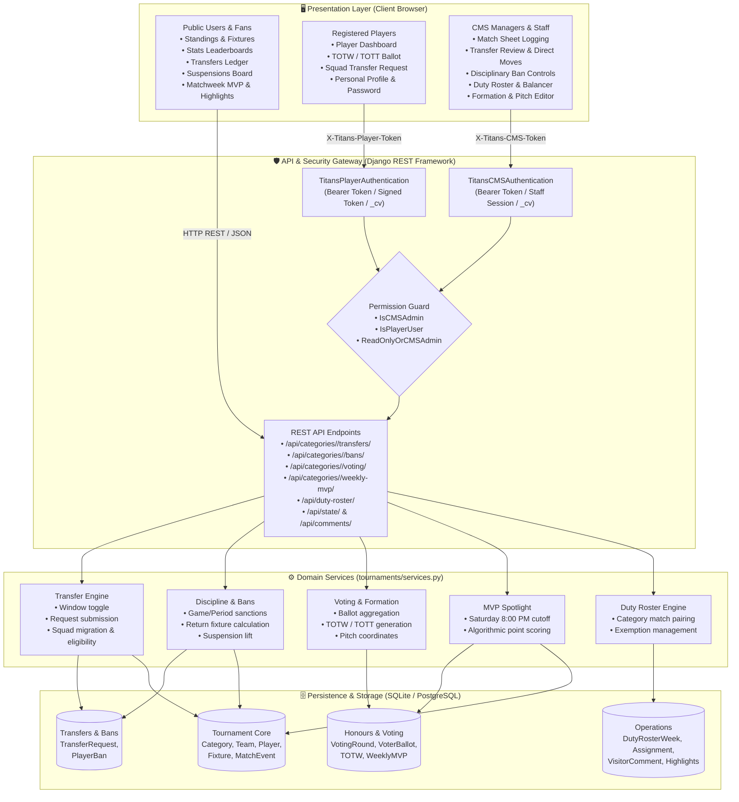
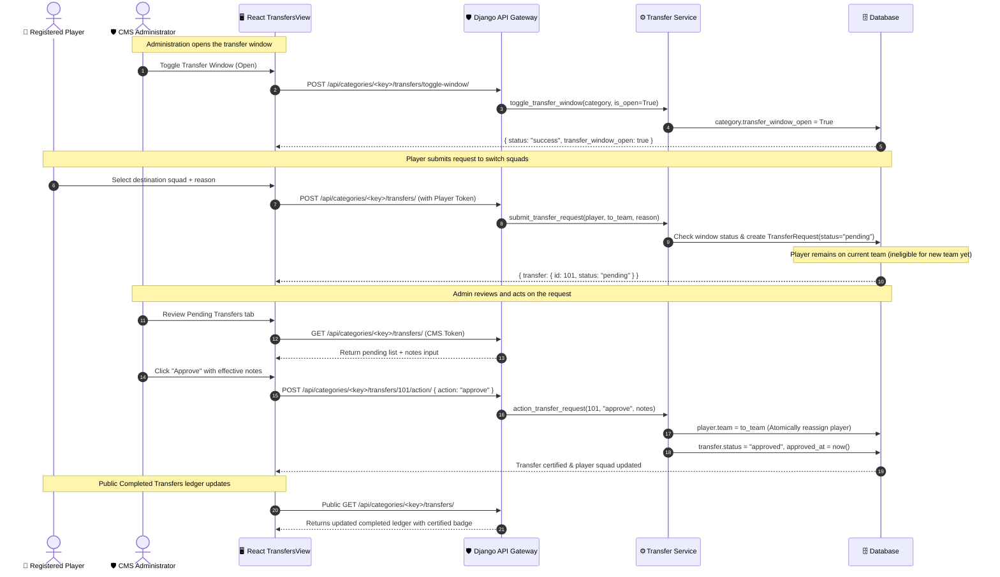
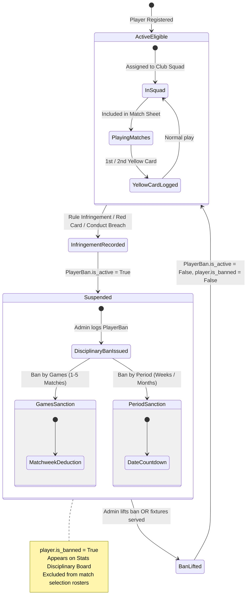
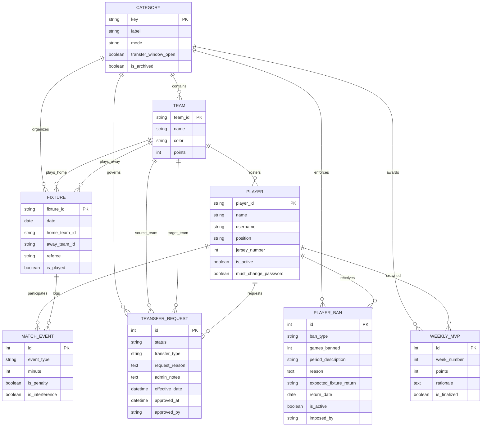

# Ruiru Titans FC — Platform Architecture & System Design

This document details the architectural blueprints of the Ruiru Titans FC platform. It illustrates the interactions between the React single-page frontend, the Django REST Framework API layer, modular domain services, and database persistence models.

---

## 1. High-Level System Architecture

---

## 2. Transfer Window & Approval Workflow

---

## 3. Player Disciplinary Ban & Eligibility State Machine

---

## 4. Entity Relationship Diagram (ERD)

---

## 5. Architectural Principles & Guarantees

1. **Separation of Privileges (Role Isolation)**:
   - Public visitors have read access to stats, transfers, and fixtures without credentials.
   - Player accounts are authenticated with signed HMAC tokens verifying credential fingerprints (`_cv`), scoped strictly to their own ballots, profile, and squad requests.
   - Manager credentials (`is_staff` / `is_superuser`) are required for state persistence, match sheets, ban modifications, and transfer approvals.
2. **Atomic Squad Transfers**:
   - Transfer requests remain `pending` until approved. Updating squad membership executes via `player.save(update_fields=["team"])`, preserving event history while transitioning the player across future match sheets.
3. **Automated Disciplinary Synchronization**:
   - `player.is_banned` and `active_ban` are calculated dynamically on the model layer, ensuring consistency across API responses, client leaderboards, and roster pickers.
