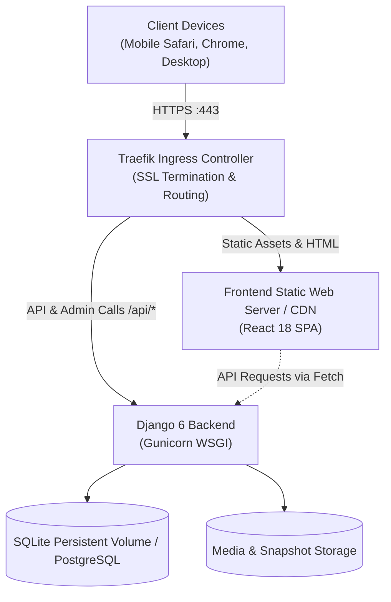
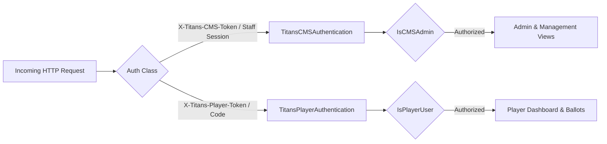
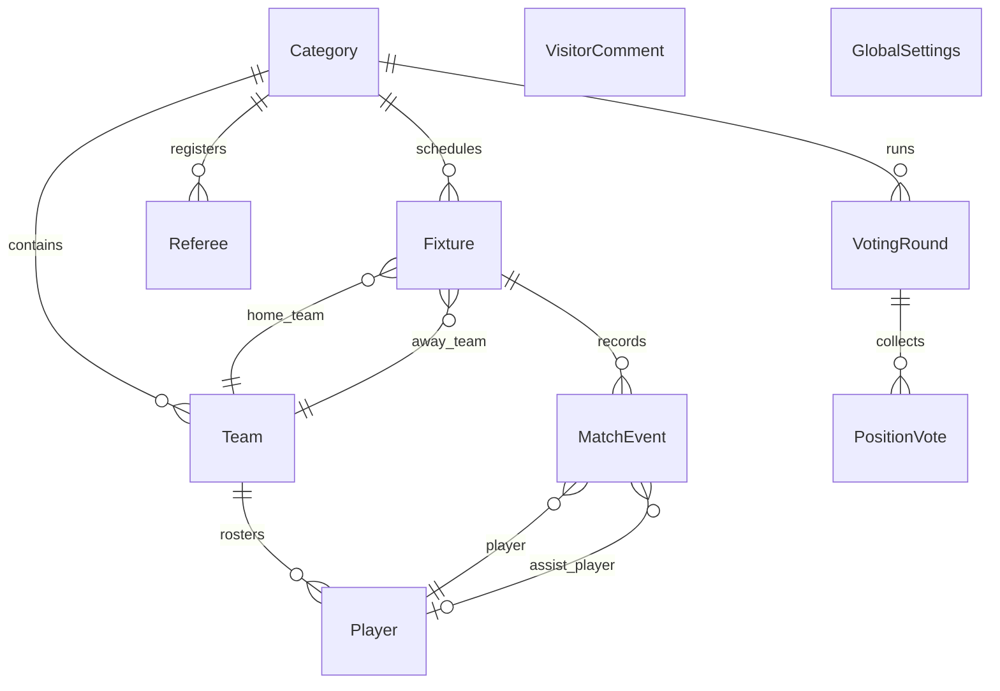

# Ruiru Titans Architecture & Technical Specifications

This document outlines the architectural design, security model, data models, and system flows of the **Ruiru Titans Football & Tournament Management Platform**.

---

## 1. System Overview

Ruiru Titans is designed as a hybrid full-stack web application combining a **Python Django 6 backend** (REST API, ORM, authentication, and reporting engines) with a **React 18 Single-Page Application (SPA)** frontend built via Vite.

---

## 2. Backend Architecture

### 2.1 Django REST Framework (DRF) API
The backend exposes clean REST endpoints adhering to JSON standards:
- **Central State API (`/api/state/`)**: Returns the full tournament state dictionary for immediate optimistic caching on the client.
- **Granular Category APIs (`/api/categories/<key>/`)**: CRUD operations on specific tournament categories, fixtures, standings, and rosters.
- **Match Event Engine (`/api/fixtures/<id>/events/`)**: Granular recording of goals, penalties, own goals, assists, yellow cards, red cards, and match reports.
- **Duty Roster Engine (`/api/categories/<key>/duty-roster/`)**: Automated assignment and tracking of team bib washing and goalpost storage logistics.
- **Community Reactions API (`/api/comments/`)**: Public visitor submissions with admin moderation filter.

### 2.2 Dual Authentication System
The platform implements two distinct, mutually isolated authentication contexts:

1. **CMS / Admin Authentication**:
   - For team managers, referees, and tournament directors.
   - Authenticated against Django's built-in `User` model (`is_staff=True` or `is_superuser=True`).
   - Supports signed token headers (`X-Titans-CMS-Token` / `Authorization: Bearer <token>`) salted with `titans-cms-auth`, or active Django session cookies.
   - Enforces **Credential Fingerprinting (`_cv`)**: If an administrator changes their credentials, active tokens and sessions are immediately invalidated.

2. **Player Account Authentication**:
   - For registered squad players.
   - Authenticated against the `Player` model using `username` or `player_id`.
   - Supports 4-digit activation codes generated by managers (valid for 24 hours).
   - Enforces **Brute Force Lockout**: Locked out after 5 consecutive incorrect code attempts.
   - Password hashes automatically upgrade from legacy plaintext to Django standard algorithms (`pbkdf2_sha256`, `argon2`, or `bcrypt`) on first successful login.

---

## 3. Data Models & Entity Relationships

The relational schema is defined in [`tournaments/models.py`](file:///home/marie/Desktop/ruirutitans/tournaments/models.py):

### Model Descriptions
- **`Category`**: A tournament competition. Supports `league` mode (single/double round-robin) and `cup` mode (group stages + knockout bracket). Stores schedule metadata, venue, duty roster configs, and archive status (`is_ended`, `champion_team`, `runner_up_team`).
- **`Team`**: Squads enrolled in a category. Retains `team_id`, name, and team accent color hex codes.
- **`Player`**: Individual team members. Retains `player_id`, `name`, `first_name`, `surname`, `username`, `dob`, `active_foot`, `preferred_positions`, `position`, `jersey_number`, and authentication credentials.
- **`Fixture`**: Scheduled match ties. Tracks dates, venues, home/away scores, walkover awards, penalty shootouts, match reports, and status (`played`).
- **`MatchEvent`**: Granular match incidents: `goal`, `owngoal`, `assist`, `yellow`, `red`, with penalty flags and sideline interference flags.
- **`VotingRound`**: Weekly awards window (e.g., Team of the Week). Tracks opening/closing dates and voting tallies.
- **`PositionVote`**: Individual ballots cast by players for specific pitch positions.
- **`VisitorComment`**: Public community reactions and comments. Requires `is_approved=True` before displaying in public carousels.
- **`GlobalSettings`**: System-wide feature flags and site configuration.

---

## 4. Frontend Architecture

The frontend is a decoupled React 18 single-page application located in [`frontend/`](file:///home/marie/Desktop/ruirutitans/frontend/):
- **Build Tool**: Vite (`vite build` creates minified bundles in `frontend/dist/`).
- **Design Philosophy**: Grounded in Apple Human Interface Guidelines (HIG) with sports branding (Pitch Dark `#0F2E24`, Deep Obsidian `#10221B`, Gold `#C9A227`, and Safety Amber `#FF9500`).
- **State Flow**:
  - Top-level `App.jsx` handles global tournament state, category switching, optimistic updates, and authentication modals.
  - Sub-views receive localized state slices and dispatch mutations via `frontend/src/api/client.js`.
  - Offline fallback: If backend is unreachable, the client falls back to `defaultState.js` and local storage caches.

---

## 5. Automated Backup & Disaster Recovery

The platform includes a zero-downtime, automated backup subsystem:
- **Command**: `python manage.py backup_database`
- **Engine**:
  - Performs an atomic snapshot of SQLite using the SQLite online backup API or raw gzip compression.
  - Simultaneously exports a complete tournament JSON state snapshot (`state_snapshot_YYYYMMDD_HHMMSS.json.gz`).
  - Prunes backups older than the retention threshold (defaults to 14 days).
- **Automation**: Executed automatically via a Kubernetes CronJob (`ruirutitans-backup-nightly`) at 02:00 UTC daily.
